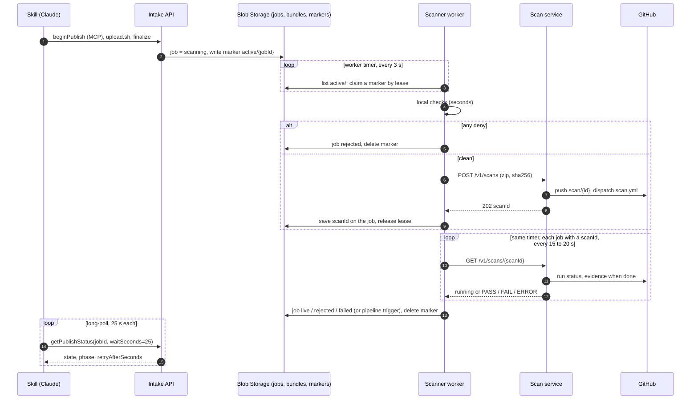

# Asynchronous scan design

Status: proposed, 2026-11-10. The scan service row of section 12 is built and tested (see the README's test
status); everything in the artifacts repo (intake, scanner, skill, contracts, infra) is not built yet.
Scope: how a 4 to 5 minute GitHub-backed scan fits the publish flow end to end:
skill → APIM (MCP) → intake API → scanner worker → scan service → GitHub.

Measured baseline: one scan takes about 4.5 minutes on a public-repo runner (CodeQL init about 1 minute,
analysis about 3). Private-repo runners are smaller, so plan for 5 to 7 minutes.

## 1. Decisions

| # | Decision | Reason |
|---|---|---|
| D1 | The GitHub scan is a **gate for every tier**. Nothing goes live without a `PASS` bound to the sha256 of what was scanned. `ERROR` blocks. | The control being claimed is that AI-generated code is scanned before it is hosted; a detector cannot support that claim. |
| D2 | **No call is held longer than 30 seconds.** The wait lives in durable job state, never in a connection or in process memory. | Tool calls, APIM and blob leases all time out well before 5 minutes. |
| D3 | **Every hop is idempotent and resumable.** A crash or redelivery at any point loses no publish and starts no duplicate scan. | Scans cost runner minutes and the flow spans four systems. |
| D4 | **Polling is the source of truth; push is only an accelerator.** | GitHub does not retry failed webhook deliveries on its own. |
| D5 | **Service-to-service calls use Entra workload identity tokens, not shared secrets.** | Matches the artifacts platform's existing decision (T18). Replaces `SCAN_API_TOKEN`. |
| D6 | **Roll out in shadow mode first**, then enforce. | Measures latency and false positives on real traffic before anyone is blocked. |
| D7 | **No message broker. Blob Storage holds the job record and the hand-off.** Service Bus is removed. | One source of truth for job state, and one fewer resource to secure, monitor and keep available. |
| D8 | **Scan the source, trust the build.** For static artifacts compiled on the author's side, the source is uploaded with the bundle and the source is what GitHub scans. The compiled bundle is published without proof that it came from that source. | CodeQL largely skips minified output and a compiled bundle has no lockfile, so scanning it finds almost nothing. The threat is AI mistakes, not a hostile publisher. See 4.5. |

## 2. Targets

Proposed numbers; confirm before build.

| Target | Value |
|---|---|
| Rejection by local checks (zip, secrets, HTML/Python/JS rules) | p95 under 30 seconds |
| Time from finalize to verdict | p50 under 6 minutes, p95 under 10 minutes |
| Status endpoint availability | 99.9% |
| Sustained load | 60 publishes an hour, 20 scans in flight |
| Publishes that went live without a matching `PASS` | 0, verified by a daily audit query |
| Evidence retention | per records policy, immutable |

## 3. Flow

## 4. Protocol per hop

### 4.1 Skill to intake API (MCP)

- `getPublishStatus` gains an optional `waitSeconds` (maximum 25). The call returns as soon as the state or phase
  changes, or when the wait ends. Clients that do not send it behave as today.
- The response gains three additive fields: `phase` (`local_checks`, `deep_scan`, `publishing`), `phaseStartedAt`
  and `retryAfterSeconds`. `state` stays `scanning`; the frozen state machine is unchanged.
- Skill step 8 becomes: tell the user once that a deep scan takes about 5 minutes, then long-poll quietly for up
  to 15 minutes. At the budget, give the job id in one sentence and stop. A later "is it live?" is one call.
- On HTTP 429 the skill waits for `Retry-After` and continues. It never restarts the publish.
- A repeated finalize of the same bytes already returns `409 duplicateOf`; the skill polls that job.

About 10 to 12 MCP calls per publish instead of about 27, and no fixed sleep in the sandbox.

### 4.2 Scanner worker (one timer, Blob Storage as the hand-off)

The worker stays because it is the isolation and privilege boundary: it is the only component that opens
untrusted bundles, and the only one allowed to write to the serving store or trigger a deploy pipeline. It does
not wait on scans.

There is no message broker. The job record in Blob Storage is the only state, and a small marker blob says
"this job needs work".

- **Hand-off:** at finalize, intake sets the job to `scanning` and writes an empty marker `active/<jobId>` in the
  `jobs` container. The
  marker is deleted when the job reaches a terminal state. Listing `active/` therefore returns only in-flight
  jobs, however long the job history grows.
- **Claiming:** every 3 seconds the worker lists `active/` and takes a 60-second **blob lease** on a marker
  before touching the job. A second replica gets a conflict and moves on. The lease is renewed while the handler
  runs and released when it ends.
- **New job (no `scanId` yet):** local checks, then submit to the scan service and write
  `job.scan = { scanId, submittedAt, deadline, attempt }`. Seconds of work.
- **Job with a `scanId`:** at most one status call every 15 to 20 seconds. Still running: release the lease.
  Final: re-read the bundle from the intake store and settle the job exactly as today (static copy, or pipeline
  trigger), then delete the marker.
- **Crash recovery:** a worker that dies stops renewing; its lease expires within 60 seconds and another
  replica claims the marker. A repeated submit returns the same in-flight scan, because the scan service is
  idempotent on sha256.
- **Settling is also a conditional write** on the job record (ETag), so a lease that expired mid-settle cannot
  produce two publishes.
- **Poison bundles:** each claim increments `attempts` on the job. After 3 the job becomes `failed` and an alert
  fires. This replaces a dead-letter queue.
- **Deadline:** 25 minutes after submit the job becomes `failed` with `GH-000` and a resubmit message.
- **One automatic retry:** an `ERROR` caused by infrastructure (run did not start, GitHub unavailable) is
  resubmitted once. An `ERROR` from a verdict or commit mismatch is never retried.
- **Smallest code change:** intake and the worker already talk through a queue interface with an in-memory and
  a Service Bus implementation. A Blob-backed implementation of that interface (publish writes the marker,
  subscribe is the list-and-lease loop) replaces Service Bus without touching the worker's stage logic.

### 4.3 Worker to scan service

- `POST /v1/scans` is idempotent on sha256: a redelivered submit returns the scan already in flight.
- **Admission control:** above the configured number of scans in flight the service answers `429` with
  `Retry-After`. The worker marks the job as waiting to submit and its timer tries again; nothing is dropped.
- **Authentication:** the worker's managed identity requests a token for the scan service's app registration;
  the service validates issuer, audience and the caller's object id against an allowlist.
- **Correlation:** the worker sends `jobId` and a W3C `traceparent`; the service records both on the scan.

### 4.4 Scan service to GitHub

- Verdict collection stays pull-based: each status call advances the scan one step, and a reconcile job runs
  every minute for scans nobody is polling.
- **Run lookup must not depend on one page of results.** Search dispatched runs created after the dispatch
  time, paginated, matched on `run-name`, workflow path, event and branch.
- **Concurrent finalisation:** two replicas may advance the same scan. Writes use the store's ETag so exactly one
  records the verdict; the other re-reads.
- **Optional accelerator:** a `workflow_run` webhook, HMAC-verified, that only triggers an immediate advance.
  If it is lost, polling still finishes the scan. Add it only if p95 latency needs it.

### 4.5 What gets scanned: source, not the compiled bundle

Only the static tier has this gap. A python bundle is its own source (`app.py`), and a node bundle is source
plus lockfile that the pipeline installs, so on those tiers what is scanned is what runs.

| Artifact | Sent to the GitHub scan | Published |
|---|---|---|
| Static, hand-written | The bundle | The bundle |
| Static, compiled (React, Vue, Vite and similar) | The **source bundle** | The compiled bundle |
| Static, exported from a script (for example Plotly to HTML) | The **source bundle** (the script) | The exported files |
| Python, node | The bundle | The bundle |

How it works:

- **Manifest.** An optional `source` entry says a source bundle accompanies the artifact. `beginPublish` then
  returns a second one-time upload URL. Finalize carries both sha256 values.
- **Skill.** It stages a copy of the source in a second staging directory (the user's tree stays read-only):
  application source, `package.json`, the lockfile and build configuration. No `node_modules/`, no `.env*`, no
  build output. `upload.sh` uploads both zips. Bytes never go through a tool call.
- **Storage.** `<jobId>.source.zip` in the `intake` container, with the same lifetime as the bundle.
- **Worker.** Local checks run on the compiled bundle, as today, because that is what is served. The source zip
  gets the same archive validation and the secrets check, and only then goes to the scan service.
- **Job record.** `bundleSha256`, `sourceSha256`, and on the scan `scanned: "source" | "bundle"` with the sha256
  the verdict is bound to. The audit trail shows both, every time.
- **No source supplied.** The bundle itself is scanned. If it looks compiled, the verdict lists the files the
  scanner could not analyse (`GH-007`). Whether that is a warning or a rejection is open decision 6.

What this does and does not prove:

- It proves the submitted source was scanned and passed.
- It does **not** prove the compiled bundle was built from that source. A clean source and a different bundle
  would pass. The control is worded "source was scanned", never "the hosted artifact was scanned".
- A mismatched bundle is still subject to the local checks and runs inside the browser sandbox (no network, no
  forms, no frames). Those contain it; they do not detect it.
- If the claim ever has to be provable, the upgrade is for the platform to build from the scanned source in the
  deploy pipeline and publish its own output. Nothing in this design blocks that.

Source carries more than a compiled bundle (comments, unused files, configuration), so the secrets check before
the push to GitHub is mandatory in the real environment, and open decision 3 covers source as well.

## 5. Timeout hierarchy

Each layer gives up after the one below it, so the cause is always reported by the layer that knows it.

| Layer | Limit | On expiry |
|---|---|---|
| Workflow job (`timeout-minutes`) | 15 minutes | Run cancelled; verdict step still writes `ERROR` |
| Scan service (`SCAN_TIMEOUT_SECONDS`) | 20 minutes | Scan `ERROR`, run cancelled, branch deleted |
| Worker scan deadline | 25 minutes | Job `failed`, `GH-000`, resubmit message |
| Skill polling budget | 15 minutes | Skill stops polling; the job continues server-side |
| Any single HTTP or MCP call | 30 seconds | Caller retries with backoff |

## 6. Failure modes

| Failure | Effect | Handling |
|---|---|---|
| Worker crashes mid-job | Its lease expires within 60 seconds | Another replica claims the marker; a repeated submit returns the in-flight scan for the same sha256 |
| Two replicas reach the same job | Double processing attempt | The lease admits one; settling is also a conditional write |
| A bundle crashes a check every time | Endless re-claiming | `attempts` on the job; after 3 the job is `failed` and an alert fires |
| Intake crashes between setting `scanning` and writing the marker | Job with no marker | The maintenance timer recreates markers for `scanning` jobs older than 1 minute that have none |
| Storage account unavailable | Nothing progresses | Intake already depends on it; jobs resume when it returns |
| Compiled bundle was not built from the scanned source | Scanned code is not the served code | Not detectable in this model (D8). Contained by the local checks and the browser sandbox; both hashes are on the audit record |
| Worker is down while a scan finishes | Verdict collected late | The timer picks the job up when a replica is back; the deadline still applies |
| Scan service replica dies mid-scan | None | State is in the store; any replica continues |
| GitHub Actions queue is slow | Longer `deep_scan` | Within the 15-minute job limit it simply waits |
| GitHub unavailable | Push or dispatch fails | `ERROR` (infrastructure), one automatic retry, then `failed` with a clear summary. Never auto-allow. |
| Runner job never starts (for example a billing lock) | Run fails in seconds with no evidence | `ERROR`; alert on the first occurrence |
| Evidence missing, or verdict for another commit | Possible tampering or a bug | `ERROR`, not retried, security alert |
| Policy changes during a scan | Old verdict under a new policy | Verdict carries `policy_version`; the cache only reuses a matching version |
| GitHub API rate limit reached | Status calls fail | Treated as transient; admission control lowers intake; alert at 20% remaining |
| Skill gives up or the user closes Claude | None | Job completes server-side; status is available by job id |

## 7. Security and audit

- **Verdict integrity.** A verdict is accepted only from a run of `scan.yml` dispatched on the default branch,
  with matching request id and commit SHA, and the caller publishes only when the sha256 matches the bytes it sent for scanning.
- **No bypass in v1.** There is no override flag in the service or the worker. An exception is a security
  decision recorded outside the system.
- **Evidence.** `verdict.json` and raw scanner output go to the `scan-evidence` container, which has a
  write-once retention policy (section 8). Key: `<scanId>.zip`, linked from the job record.
- **Audit trail.** One structured record per transition with `jobId`, `scanId`, commit SHA, run id, publisher
  object id, policy version and outcome.
- **Data handling.** Bundles are copied to GitHub for the scan. The scan repo is private, `scan/*` branches
  are deleted on completion, and what may be published must be cleared for that location by data classification.
- **Secrets.** GitHub App key in Key Vault through the CSI driver. No shared bearer tokens between services.

## 8. Storage layout

One storage account (the existing zone-redundant one), five private containers. Three exist today; two are new.
Access is granted per container, as it is now.

| Container | Status | Holds | Writes | Reads |
|---|---|---|---|---|
| `intake` | exists | Uploaded bundles `<jobId>.zip` and, for compiled or exported static artifacts, the source bundle `<jobId>.source.zip` | Intake API | Scanner worker, pipeline |
| `jobs` | exists | Job records `<jobId>.json`, `by-artifact/` index, and the new `active/<jobId>` markers | Intake API, scanner worker | Both |
| `serving` | exists | Published static files `<artifactId>/...` | Scanner worker, pipeline | Static gateway |
| `scans` | new | Scan records `scans/<scanId>.json` and the lookup `by-sha/<sha256>` | Scan service | Scan service |
| `scan-evidence` | new | `<scanId>.zip`: `verdict.json` plus raw scanner output | Scan service, create only | Security team, auditors |

Why the split:

- **Markers share `jobs`.** Both writers already have access, and the `active/` prefix lists separately from the
  `job_` records.
- **`scans` is its own container** so the scan service's identity cannot read bundles or change job records.
- **`scan-evidence` is separate from `scans`** because an immutability policy covers a whole container. Scan
  records change while a scan runs; evidence is written once.

Settings on the two new containers:

- Excluded from Defender on-upload scanning, as `serving` already is. They hold JSON and scanner output.
- `scan-evidence`: time-based retention (write once, no delete) for the period in open decision 4.
- `scans`: a lifecycle rule that deletes old records; evidence is the long-term copy.

The root of truth is `jobs` plus `intake`. Markers, scan records and the sha256 lookup can all be rebuilt from
them; evidence cannot, which is why it is immutable.

## 9. Capacity and limits

Confirm the plan-specific numbers with your GitHub account team.

| Constraint | Planning figure | Consequence |
|---|---|---|
| Runner minutes per scan | 5 to 7 | 60 publishes an hour is 300 to 420 runner minutes an hour |
| Concurrent hosted-runner jobs | plan-dependent | Admission limit in the scan service stays below it |
| GitHub API calls per scan | about 15 | Far below an App installation's hourly limit at target load |
| APIM rate limit | 60 a minute, keyed by IP today | Key by user object id; Cowork users share egress addresses |
| Blob operations for the hand-off | one list every 3 seconds per replica, a few writes per job | Negligible cost, no new Azure resource |
| Pick-up delay for a new job | up to 3 seconds | Acceptable against a 5-minute scan |

Levers if latency or cost matters: default query suite instead of `security-extended`, a larger runner, and
the sha256 verdict cache (a re-publish of identical bytes costs nothing).

## 10. Observability

- **Metrics:** time in each phase (histogram), scans in flight, active markers and the age of the oldest,
  verdicts by status, `GH-000` by cause, 429s issued, GitHub API quota remaining, jobs that used up their attempts.
- **Tracing:** `traceparent` from intake through worker and scan service; the Actions run URL on the span.
- **Alerts:** p95 time to verdict over target for 15 minutes; `ERROR` rate over 5%; any scan past its deadline;
  any job that used up its attempts; any marker older than 30 minutes; any verdict mismatch; daily audit query
  not zero.
- **Dashboard:** one view from finalize to live, split by phase and tier.

## 11. Rollout

| Stage | Behaviour | Exit criterion |
|---|---|---|
| 0. Shadow | Scan runs on every publish; verdict recorded, not enforced; publish path unchanged | Two weeks of data: latency within target, false-positive rate understood |
| 1. Enforce python and node | Gate before the deploy pipeline | No unexplained `ERROR`s for a week |
| 2. Enforce static | Gate before the serving copy, on the source scan where a source bundle is supplied; skill text no longer promises "seconds" | Open decision 6 settled; publisher communication sent |

A single setting on the worker selects `off`, `shadow` or `enforce` per tier.

## 12. Changes by component

| Component | Change | Size |
|---|---|---|
| Scan service (this repo) | Entra token validation; admission control with 429; paginated run lookup; ETag writes; `/metrics`; reconcile every minute; structured audit log; evidence written to its own container; minified files reported as not analysed instead of rejected | about 6 files |
| `intake-api` | `waitSeconds` long-poll; `phase`, `phaseStartedAt`, `retryAfterSeconds` on status; `job.scan` on the record; second upload URL and sha256 for the source bundle | about 5 files |
| `scanner` | One timer that claims jobs by lease, submits new ones and collects verdicts, with conditional writes, attempts, deadline, retry and mode switch; scan service client behind an interface with a fake | about 5 files |
| `intake-api/src/stores` | Blob-backed implementation of the existing queue interface (marker blobs, list-and-lease loop); marker written at finalize | 2 files |
| `infra/bicep` | Remove the Service Bus namespace and its role assignments; add the `scans` and `scan-evidence` containers with role assignments, Defender exclusions, retention and lifecycle rules | 2 files |
| `contracts/` | Additive status fields; `GH-*` rules; optional `source` entry in the manifest; source upload in the intake API | 3 files, needs a contract PR |
| `skill` | Step 8 polling protocol; description wording; 429 handling; stage and upload the source bundle | 2 files |
| `infra/apim` | Rate-limit key by user; `waitSeconds` passthrough | 2 policies |
| `charts` | Scan service deployment, identity, alerts | new chart |

Each row ships on its own. Order: scan service, contracts, intake, scanner in shadow mode, skill, enforce.

## 13. Considered and not chosen

| Option | Why not |
|---|---|
| Worker blocks on the scan, as it does for Defender | One message at a time means one scan every 5 minutes per replica, and the queue lock would need renewing |
| A scheduled queue message per status check | Needs duplicate detection, message ids, a sweep for lost messages and dead-letter handling to do what one timer does |
| Remove the worker; intake API runs the checks and publishes | The internet-facing service would parse untrusted bundles and hold the permission to publish |
| Keep Service Bus for the hand-off | It works, but once the worker has a timer and conditional writes it is a second mechanism, a second resource to secure and monitor, and a second place for state to disagree with the job record |
| Azure Storage Queue for the hand-off | A real queue in the same storage account. The fallback if the 3-second pick-up delay or the lease code ever becomes a problem |
| Scan service calls back to intake when done | Needs a background loop or an inbound webhook in the scan service; polling by the worker is enough at this load |
| Scan after publish on the static tier | Fast, but an unscanned artifact is briefly live and the "scanned before hosted" claim no longer holds |
| Scan only the compiled bundle | CodeQL largely skips minified code and there is no lockfile for dependency review; five minutes for almost no signal |
| Platform builds from the scanned source and publishes its own output | Makes scanned equal published by construction, but adds build time and an isolated step that runs untrusted build code. The upgrade path if the claim must be provable |
| Rebuild on the platform and compare hashes with the uploaded bundle | Needs reproducible builds; if the platform rebuilds anyway, it should publish its rebuild |

## 14. Open decisions

1. Confirm D1: a hard gate on the static tier costs every static publish about 5 minutes.
2. The SLO numbers in section 2.
3. Whether GitHub may hold bundle contents, and now source code, at your data classification, and for how long.
4. Evidence retention period.
5. Whether to add the webhook accelerator now or only if p95 misses the target.
6. A compiled static bundle that arrives without source: reject it, or publish it with a warning. Decide from
   the shadow-mode numbers.
